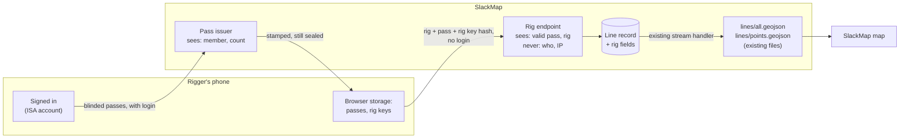
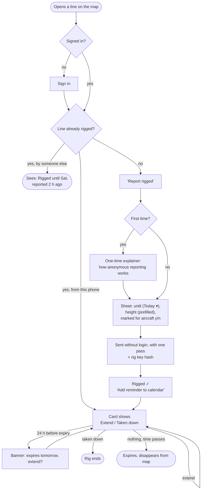
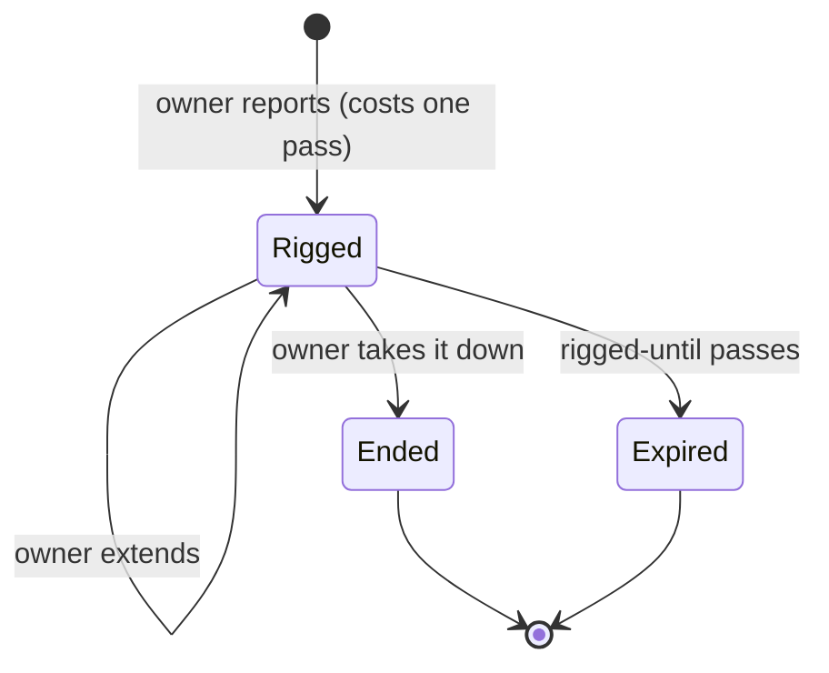
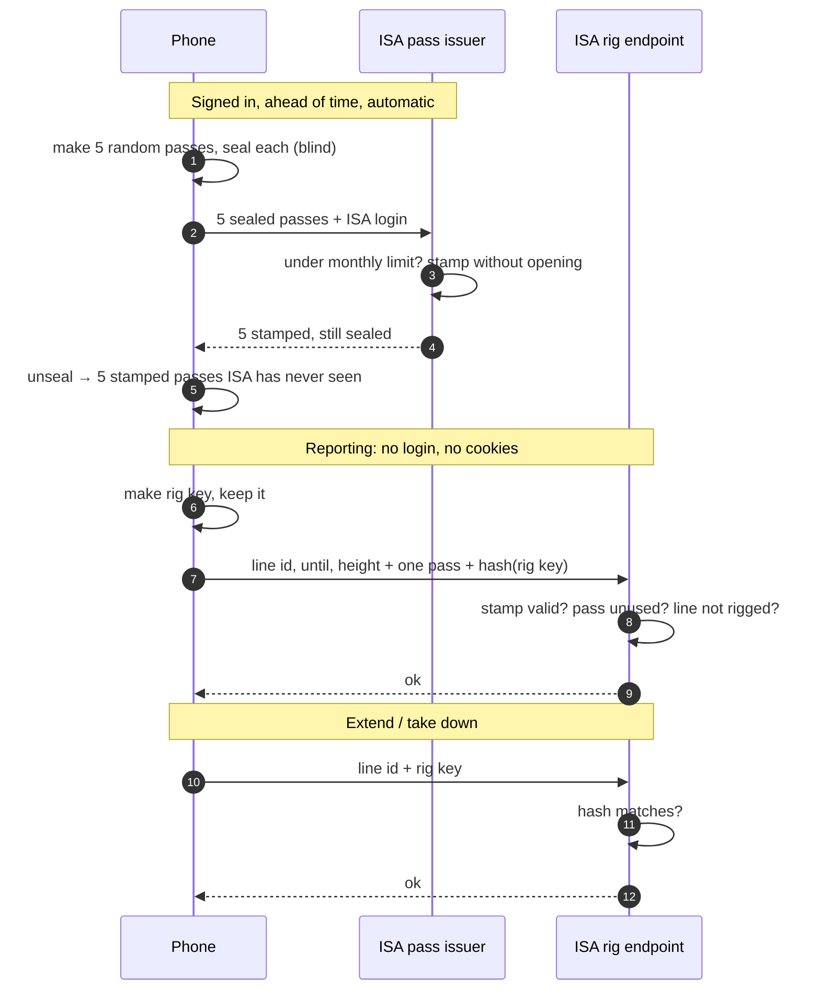

# Flows

Diagrams follow [decisions](decisions.md); an open decision can change them. Screens: [wireframes](wireframes.html).

## 1. Big picture

ISA sees both arrows into it but nothing that links them.

## 2. Rigger

## 3. A rig's life

Only the owner's phone (the rig key) or time ends a rig.

## 4. The pass (blind signature)

Details and leaks to close: [anonymity](anonymity.md).
