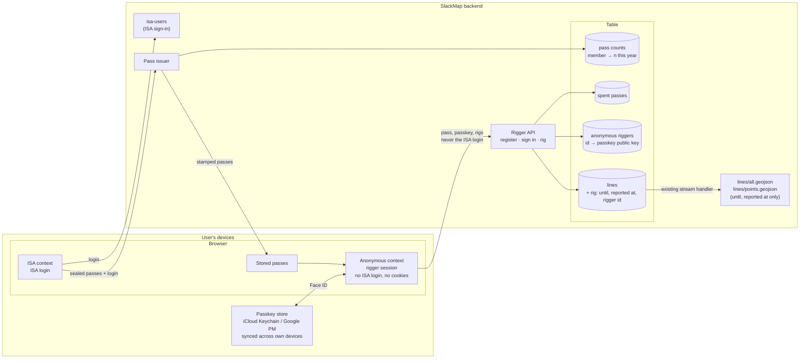
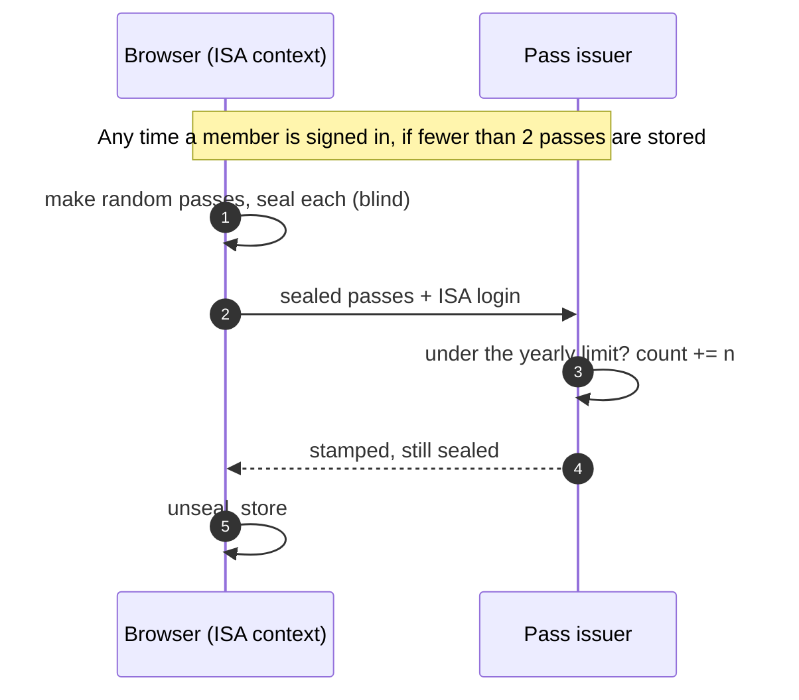
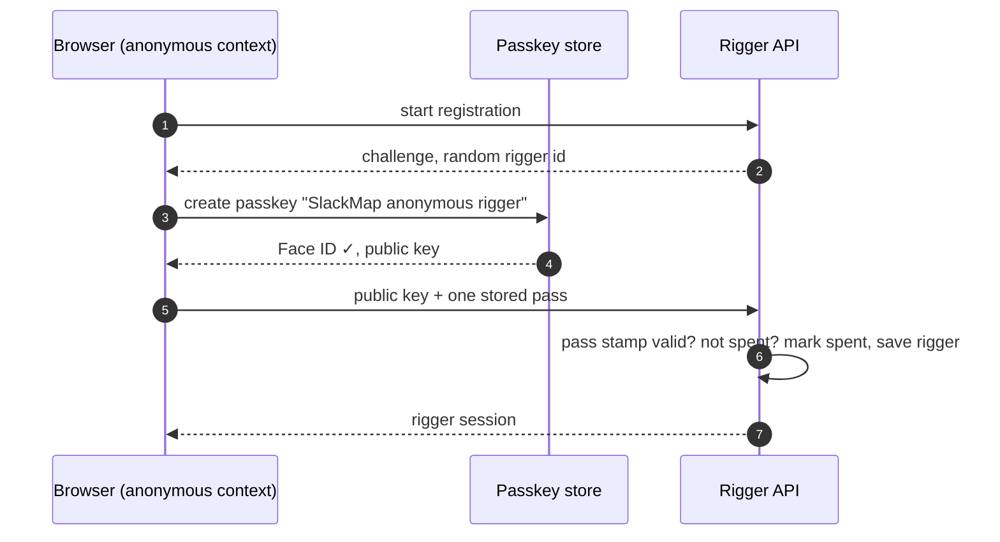
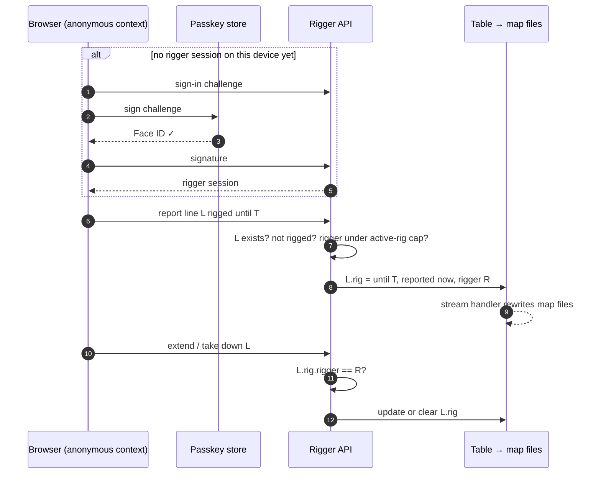
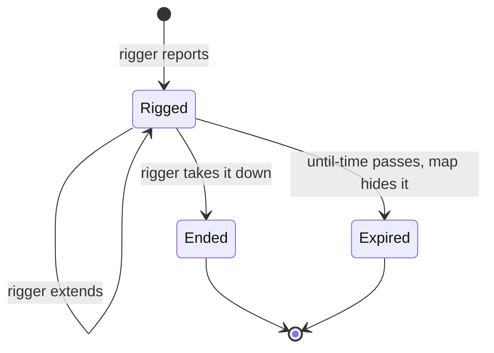
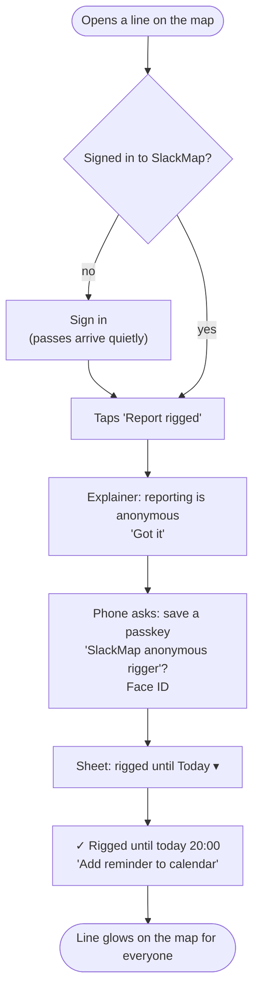
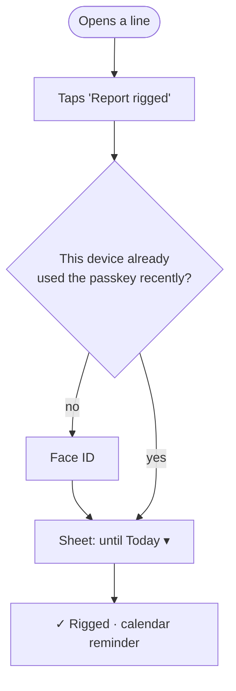
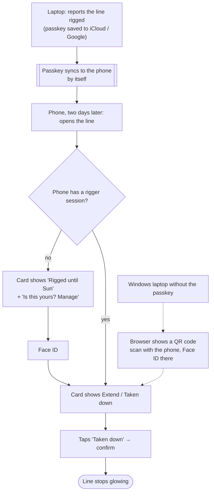
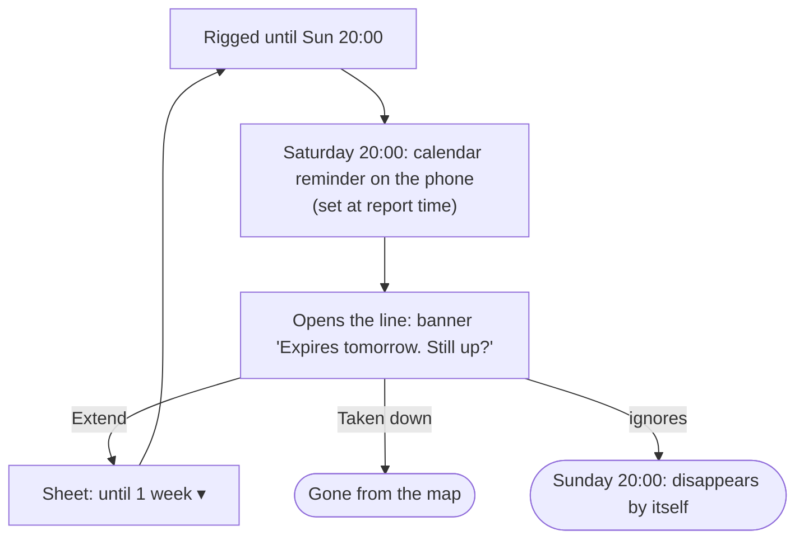
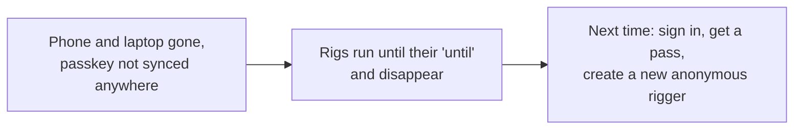

# Flows

Two views of the same design: **architecture** (what talks to what, what each part knows) and **user** (what a slackliner does and sees). Decisions behind them: [decisions](decisions.md). Screens: [wireframes](wireframes.html).

---

# Architecture

## A1. Parts and what each one knows

| Part | Knows | Never knows |
|---|---|---|
| Pass issuer | member X took n passes this year | which passes, which rigger |
| Rigger API | a valid pass was spent; rigger R owns rigs 1, 2, 3 | which member R is |
| Map files | line is rigged until T, reported at T₀ | any rigger id |
| Apple / Google | a passkey for slackmap.com exists on this person's devices | its contents (end-to-end encrypted) |

The one bridge between the left and right columns of ISA's knowledge is the stored pass, and the blind signature makes it unrecognisable.

## A2. Passes, in the background

## A3. Creating the anonymous rigger (once)

## A4. Reporting, extending, taking down

## A5. A rig's life

---

# User

## U1. First report

## U2. Every report after that

No ISA sign-in needed ([D4](decisions.md#d4-does-reporting-need-the-isa-sign-in)).

## U3. Rigged on the laptop, taken down from the phone

The "Is this yours? Manage" link replaces asking the server who owns a rig: the device proves it with Face ID, otherwise nothing is revealed.

## U4. Reminder and expiry

## U5. Lost every device

Nobody, including ISA, can recover the old rigger: that is the point.
