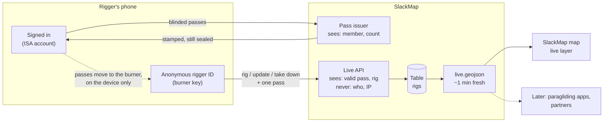
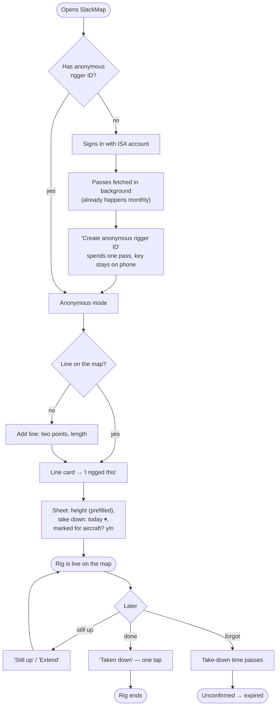
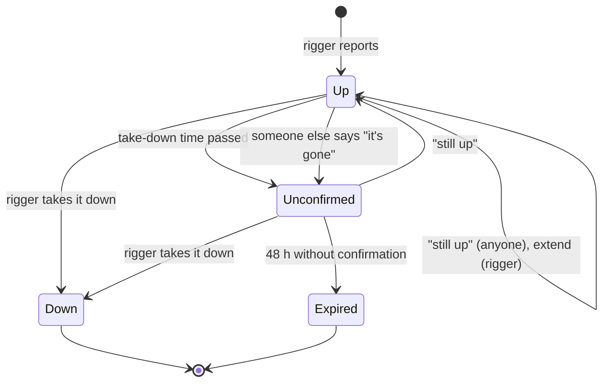
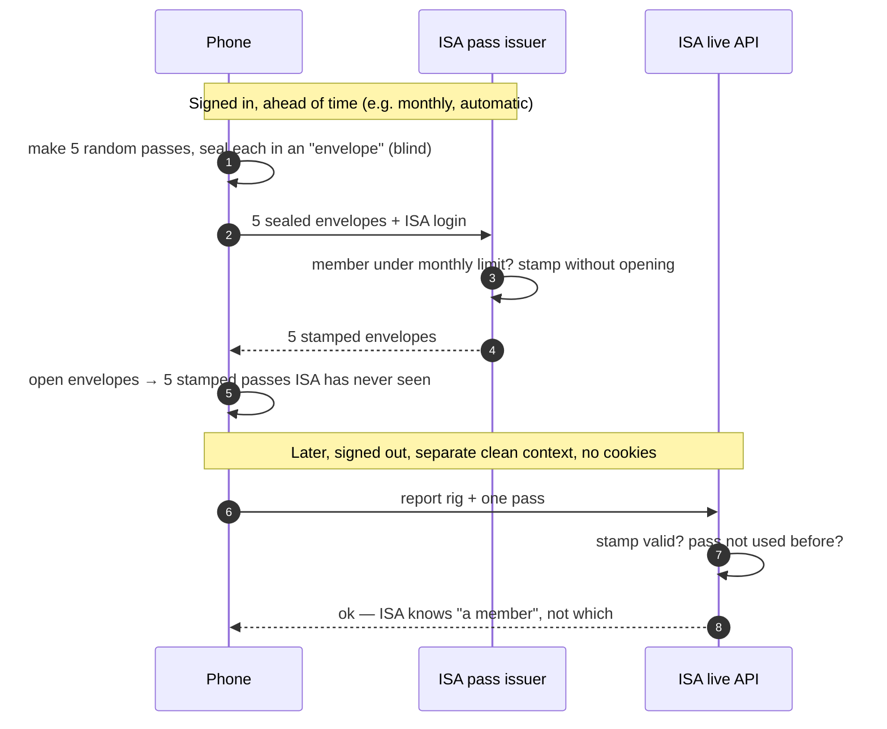
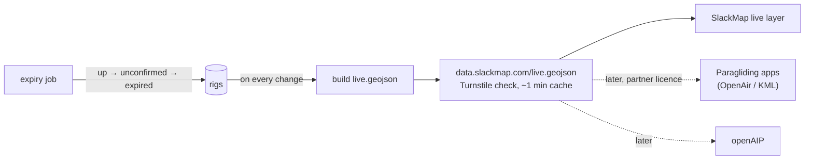

# Flows

Diagrams follow the recommendations in [decisions](decisions.md); an open decision can change them.

## 1. Big picture

The dotted arrow is the trick: ISA sees both ends but no link between them.

## 2. Rigger: from first time to take down

## 3. A rig's life

Only the rigger's burner, or time, ends a rig. A stranger's "gone" never removes it.

## 4. The anonymous pass (blind signature)

Same idea as Apple's Private Access Tokens and Cloudflare's Privacy Pass. Details and the leaks to close: [anonymity](anonymity.md).

## 5. Consumers

Every output carries: *reported lines only; no line shown ≠ no line there.*
