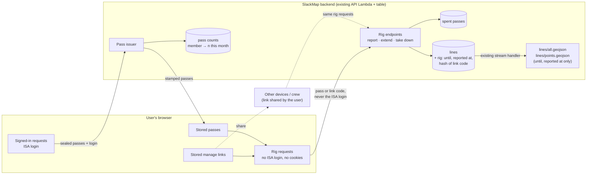
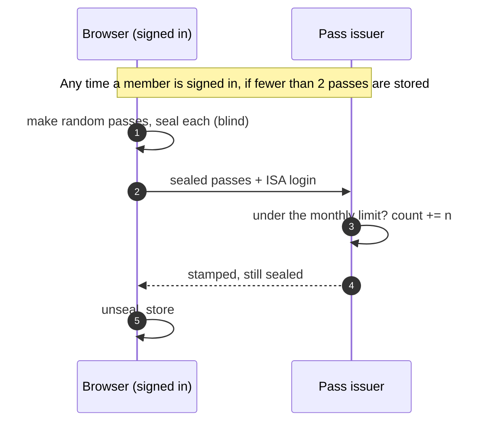
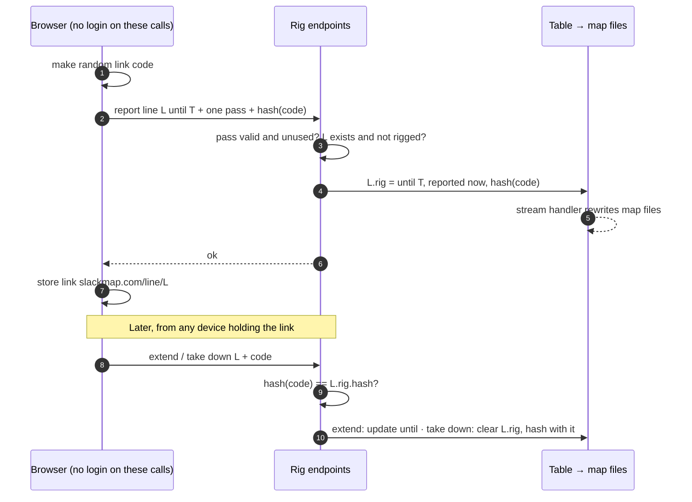
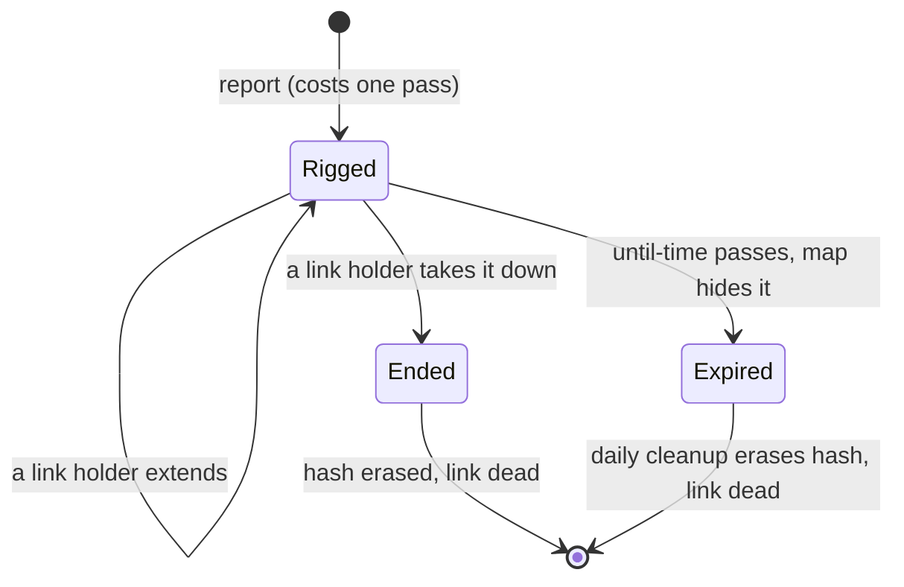
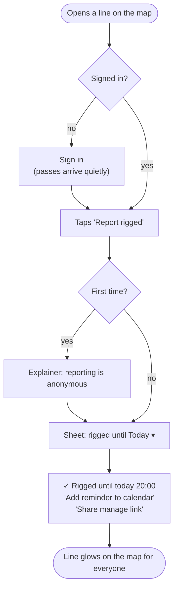
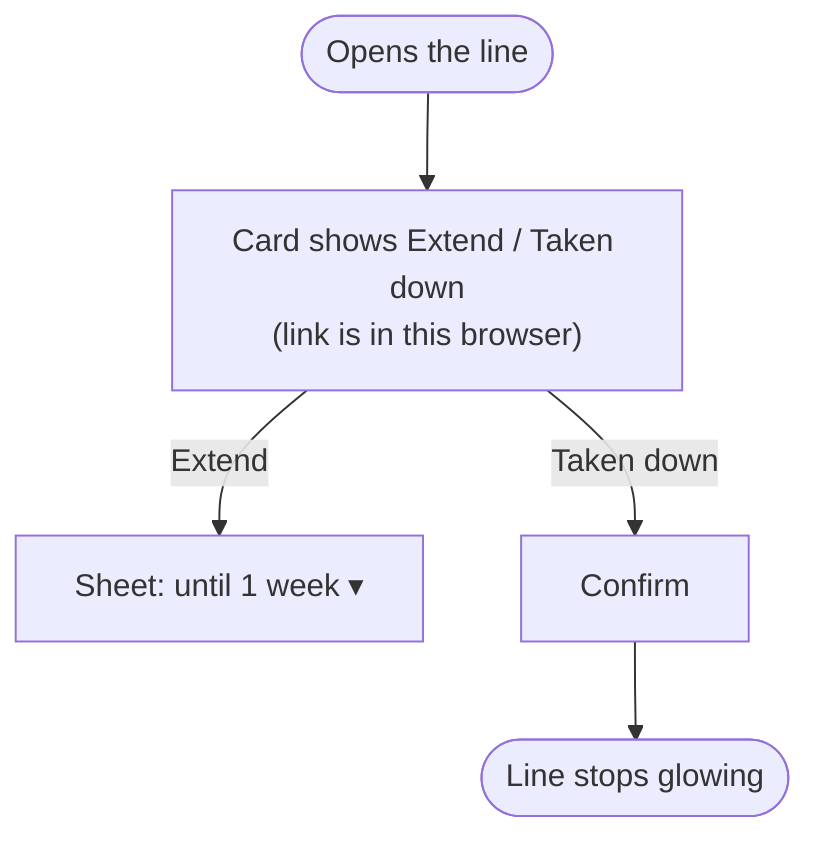
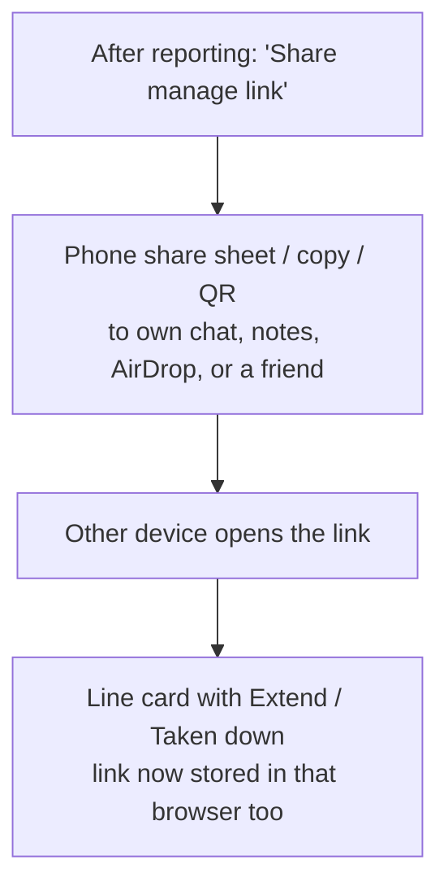
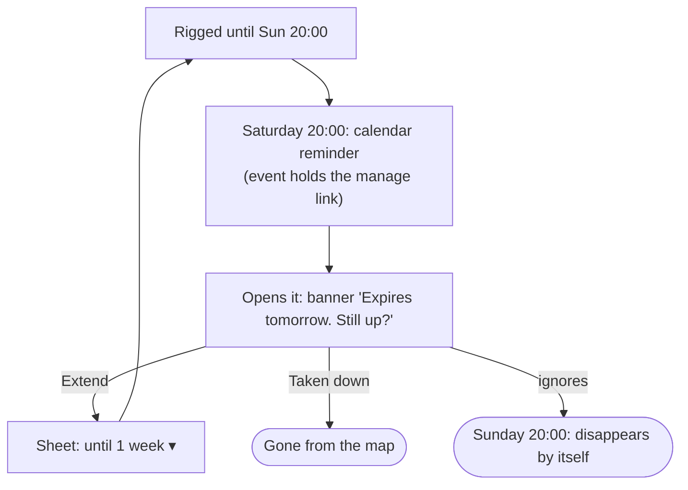
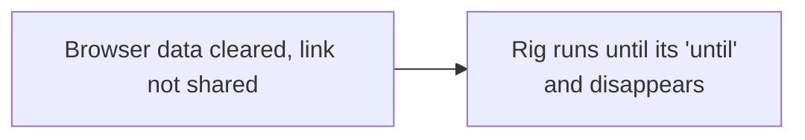

# Flows

Two views of the same design: **architecture** (what talks to what, what each part knows) and **user** (what a slackliner does and sees). Decisions behind them: [decisions](decisions.md). Screens: [wireframes](wireframes.html).

---

# Architecture

## A1. Parts and what each one knows

| Part | Knows | Never knows |
|---|---|---|
| Pass issuer | member X took n passes this month | which passes |
| Rig endpoints | a valid pass was spent on line L; this code matches L's hash | who, or which member |
| Map files | line is rigged until T, reported at T₀ | anything about the link |
| Server logs | — | the link code: it sits after `#` in the URL, which browsers never send |

The only bridge from "member X" to "rig on line L" is the pass, and the blind signature makes it unrecognisable.

## A2. Passes, in the background

## A3. Report, extend, take down

## A4. A rig's life

---

# User

## U1. Reporting

## U2. Extending or taking down, same device

## U3. Another device, or a crew member

No sign-in on the other device. Anyone the link reaches can manage that one rig.

## U4. Reminder and expiry

## U5. Lost the link

Nobody, including ISA, can recover it: ISA holds only the hash.
